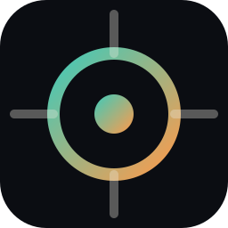
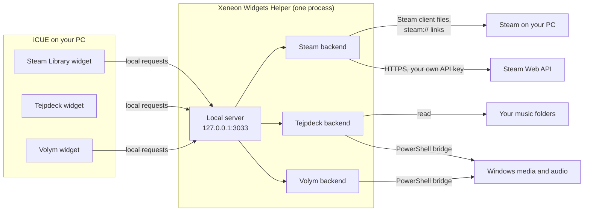

<p align="center">
  
</p>

<h1 align="center">Xeneon Widgets Helper</h1>

<p align="center">
  <b>The small Windows companion that lets iCUE widgets on the CORSAIR XENEON EDGE<br>
  reach your games, your music and your PC's audio.</b>
</p>

<p align="center">
  <a href="https://github.com/ensamvarg360/xeneon-widgets-helper/releases/latest"><b>⬇ Download the latest version</b></a>
  <br><br>
  <a href="#install">Install</a> ·
  <a href="#privacy-at-a-glance">Privacy</a> ·
  <a href="#troubleshooting">Troubleshooting</a> ·
  <a href="CHANGELOG.md">Changelog</a> ·
  <a href="SECURITY.md">Security</a> ·
  <a href="LICENSE.md">License</a>
</p>

<p align="center"><sub>Windows 10 / 11 (64-bit) · free to use · no account · no telemetry · no admin rights</sub></p>

> [!NOTE]
> An independent project by Rune & Render, not made, endorsed or supported by
> CORSAIR or Valve. These are early versions (0.0.x): every release is checked
> by a small group of testers, including on a real XENEON EDGE, before it is
> published here.

---

## What it is

iCUE widgets are small web pages that run in a sandbox inside iCUE. That
sandbox keeps your PC safe, but it also means a widget can't see which games
you have installed, start one, play your music files or change another app's
volume.

The Xeneon Widgets Helper is a tiny tray app that does exactly those things
**on the widget's behalf**. The widget asks the Helper over a local connection
on your own PC; the Helper does the job and answers. Nothing leaves your PC
unless a widget needs Steam's online data (see
[Privacy at a glance](#privacy-at-a-glance)).

- **One install serves every widget.** One background process, one tray icon,
  however many widgets use it.
- **It does nothing on its own.** You only need it if you use one of the
  widgets below.

## Do I need it?

Yes, if you use any of these widgets. Each one is installed separately in iCUE
from the [Elgato Marketplace](https://marketplace.elgato.com/icue).

| Widget | What the Helper does for it |
|---|---|
| 🎮 **Steam Library** | Sees which Steam games are installed and which one is running, starts and stops games, opens Steam's own install/uninstall dialogs, and fetches your library, friends and achievements from Steam with a Steam Web API key you provide. |
| 📼 **Tejpdeck**<br><sub>tape-deck music player</sub> | Plays music files from folders or playlists you choose, reads their tags and cover art, and shows or controls what other apps (Spotify, a browser tab, …) are playing through Windows' media controls. |
| 🎚️ **Volym**<br><sub>audio mixer</sub> | Reads and changes the volume and mute of individual apps and your output devices through Windows' audio system, and shows what each app is playing. |

## Install

1. **Download** `XeneonWidgetsHelper-Setup-X.Y.Z.exe` from the
   [latest release](https://github.com/ensamvarg360/xeneon-widgets-helper/releases/latest).
2. **Run it.** It installs for your Windows user only, into
   `%LOCALAPPDATA%\Programs\`, and **doesn't ask for administrator rights**.
3. **Done.** The Helper starts and its icon appears in the notification area
   (it may be under the **^** arrow). Your widgets connect to it by themselves.

> [!IMPORTANT]
> **"Windows protected your PC"**: the installer isn't code-signed yet, so
> SmartScreen will probably warn about an unknown publisher the first time.
> Click **More info**, then **Run anyway**. If you'd like to be sure the file
> is exactly the one published here first, verify it as described below.

<details>
<summary><b>Verify your download (optional)</b></summary>

<br>

Every release includes a `.sha256` file next to the installer. In PowerShell,
in your Downloads folder:

```powershell
Get-FileHash .\XeneonWidgetsHelper-Setup-X.Y.Z.exe -Algorithm SHA256
```

The hash shown must match the one in `XeneonWidgetsHelper-Setup-X.Y.Z.exe.sha256`
(and on the release page). If it doesn't, don't run the file.

</details>

## Using it

There's no window. Everything is in the tray icon's right-click menu:

| Menu item | What it does |
|---|---|
| **Xeneon Widgets Helper vX.Y.Z** | Shows the installed version. |
| **Widgets** | Lists the widgets currently talking to the Helper. For information only. |
| **Helper Status** | Opens the Helper's local status and Steam sign-in page in your browser (`http://localhost:3033/setup`). |
| **Start with Windows** | Starts the Helper when you sign in to Windows. On by default; untick to turn it off. |
| **View Logs** | Opens the folder with the Helper's log file. |
| **Restart Helper** | Restarts the Helper. |
| **Quit** | Stops the Helper until you start it again from the Start menu. Widgets that need it show as disconnected. |

## Privacy at a glance

| | |
|---|---|
| ✅ **Stays on your PC** | Your music, audio, settings and logs are never uploaded. Steam only receives your API key and SteamID when the Steam Library widget fetches your data. |
| ✅ **No tracking** | No telemetry, analytics, ads, crash reports or update checks. |
| ✅ **No account, no server** | The Helper's author runs no server, so there's nothing to send data to. |
| 🌐 **Only internet use** | Steam's official services, only when you use the Steam Library widget. |
| 🔒 **Local only** | The Helper listens on `127.0.0.1`, which other devices can't reach. The one exception is an optional, 2-minute phone sign-in for Steam. |

The sections under [Exactly what it does](#exactly-what-it-does) list every
connection, file and process, and [PRIVACY.md](PRIVACY.md) covers the same
from a data point of view.

## How it works



- The Helper is an [Electron](https://www.electronjs.org/) app: a Node.js
  process with a tray icon and no visible window.
- It runs a small web server on **`127.0.0.1:3033`**, the loopback address,
  which only programs on the same PC can reach.
- Each widget has its own backend inside the Helper, under its own address
  prefix (`/api/…` for Steam Library, `/music/…` for Tejpdeck, `/volym/…` for
  Volym). The Helper routes each request to the right one.

**How it keeps other programs and websites out:**

- Actions that change something on your PC (starting or stopping a game,
  changing volume, controlling playback, choosing a music folder) need a
  random per-install access token, which the Helper only hands out to callers
  on this PC.
- Every backend also checks where each request comes from. It answers a
  packaged iCUE widget and the Helper's own pages, and refuses requests made
  by ordinary websites open in your browser.

## Exactly what it does

### Connections it accepts

| Listener | When | Who can reach it |
|---|---|---|
| `127.0.0.1:3033` | Always, while the Helper runs | Only programs on this PC |
| `<your PC's LAN address>:3033` | **Only while you use the Steam Library widget's "sign in with your phone" QR code**, for at most 120 seconds, and closed as soon as sign-in completes | Devices on your local network (for example, your phone on the same Wi-Fi) |

The temporary LAN listener lets your phone open the sign-in page from the QR
code. While it's open, only the sign-in pages work from another device. Your
library data and the game controls stay token-protected, and the token can
only be obtained from this PC. If you sign in on the PC itself, no LAN
listener is ever opened.

Windows Firewall may ask whether to allow the Helper on private networks the
first time you use the QR sign-in. Allowing it is only needed for that feature.

### Connections it makes

The Helper contacts **only Steam's official services**, and only when you use
the Steam Library widget:

| Destination | Why | What is sent |
|---|---|---|
| `api.steampowered.com` | Your owned and recently played games, profile, friends list, achievements, game news | Your Steam Web API key and SteamID, as Steam's API requires |
| `store.steampowered.com` | A game's description, screenshots and genres for the detail view | The game's Steam app ID |
| `steamcommunity.com` | Confirming your "Sign in through Steam" (OpenID) | The sign-in response Steam returned to your browser |

Tejpdeck and Volym make **no internet connections**. The Helper sends **no
analytics, telemetry or crash reports**, and **doesn't check for updates**.

When you open the **Helper Status** page, your *browser* loads its fonts from
Google Fonts (`fonts.googleapis.com`, `fonts.gstatic.com`), and Steam's
sign-in and API-key pages are on Steam's own site. Those requests come from
your browser, not the Helper.

### What it does on your PC

Everything below happens **only when a widget asks for it**, and runs as your
Windows user, without administrator rights.

**Steam Library**
- Reads Steam's own registry values (`HKCU\Software\Valve\Steam`) to find
  where Steam is installed and which game is running, and reads Steam's
  library and `appmanifest_*.acf` files to see what's installed.
- Starts a game, or opens Steam's own install/uninstall dialog, by opening
  `steam://` links. Steam handles these as usual, including its own
  confirmation prompts.
- When you press Stop, it lists running processes (through Windows
  PowerShell) and asks only those inside that game's install folder to close,
  as if you'd clicked their window's close button (`taskkill`). It forces them
  closed only if you choose to.

**Tejpdeck**
- Reads audio files, tags and cover art from the folders or playlists **you**
  pick. While you browse for one, the picker lists folder names, playlist file
  names and a count of audio files. It never shows other file names or reads
  any other file's contents.
- Plays audio in a hidden Helper window.
- Runs a small Windows PowerShell script (shipped with the Helper) to read and
  control Windows' media sessions, the "now playing" info other apps report.
  It stops again when not in use.

**Volym**
- Runs small Windows PowerShell scripts (shipped with the Helper) that use
  Windows Core Audio to read and set per-app and per-device volume and mute,
  and to read media sessions. The C# code they use is shipped as readable
  source and compiled in memory. Nothing is downloaded and no extra program is
  installed.

Tejpdeck's and Volym's PowerShell scripts are started by Windows PowerShell's
full path under `C:\Windows\System32\` with a fixed argument list, and are
closed when the Helper exits.

### What it stores

All in your own user profile, never in the install folder:

| Location | Contents |
|---|---|
| `%APPDATA%\xeneon-widgets-helper\` | Settings for each widget: your Steam SteamID and Steam Web API key, Tejpdeck's chosen folders, favorites and player settings, and the per-install access tokens. Also `helper.log` (the Helper's log, capped at about 10 MB across two files) and Electron's normal cache folders. |
| `%TEMP%\xeneon-steam-helper-crash.log` | Startup and crash diagnostics, used if the Helper fails before its normal log is available. |
| `HKCU\Software\Microsoft\Windows\CurrentVersion\Run` | The "Start with Windows" entry (`electron.app.Xeneon Widgets Helper`), while that option is ticked. |

Your Steam Web API key is stored **in plain text** in `config.json` in that
folder, readable by programs running as your Windows user like any other
app's settings. You can revoke it any time on
[Steam's API key page](https://steamcommunity.com/dev/apikey).

Log files record what the Helper is doing (for example, which widgets
connected or which folder was scanned). They stay on your PC and are never
sent anywhere.

### What it doesn't do

- No telemetry, analytics, advertising, tracking or crash reporting.
- No accounts, and no server of its own.
- No automatic updates, and no downloading or running code from the internet.
- No administrator rights, drivers, services or background tasks beyond the
  tray app itself.
- No access to your files beyond Steam's library files, the music folders you
  choose, and the folder names shown while you browse for one.
- Nothing reachable from other devices, except the short, opt-in QR sign-in
  window described above.

## Updating and uninstalling

**Updating:** download the newer installer from
[Releases](https://github.com/ensamvarg360/xeneon-widgets-helper/releases) and
run it. It replaces the old version in place and keeps your settings. The
Helper doesn't update itself, so to hear about new versions, use
**Watch → Custom → Releases** at the top of this page.

**Uninstalling:**

1. **Windows Settings → Apps → Xeneon Widgets Helper → Uninstall.** This
   removes the program and its "Start with Windows" entry.
2. *Optional:* delete `%APPDATA%\xeneon-widgets-helper\` to remove your
   settings too. The uninstaller keeps them so a reinstall keeps your setup.
   If you used the Steam Library widget, you can also revoke your Steam Web
   API key on [Steam's site](https://steamcommunity.com/dev/apikey).

## Troubleshooting

<details>
<summary><b>A widget says the Helper isn't running</b></summary>

<br>

Look for the tray icon (it may be under the **^** overflow arrow). If it's
missing, start **Xeneon Widgets Helper** from the Start menu.

</details>

<details>
<summary><b>The tray icon is there, but widgets still say the Helper isn't found</b></summary>

<br>

Since iCUE 5.52, iCUE asks before a widget may contact anything, including the
Helper on your own PC. If that request was denied or never answered, iCUE
blocks it silently. Allow access for the widget in iCUE's widget access
settings (**Software Settings → Widget Access**), and update the widget if a
newer version is available. The widget reconnects by itself once access is
allowed.

</details>

<details>
<summary><b>Nothing works after installing</b></summary>

<br>

Another program may already be using port 3033. Open **View Logs** and look
for `EADDRINUSE`.

</details>

<details>
<summary><b>Something else is wrong</b></summary>

<br>

Use **View Logs**, then [open an issue](https://github.com/ensamvarg360/xeneon-widgets-helper/issues)
with your Helper version and the relevant part of `helper.log`. Look through
it first for anything you'd rather not share, such as folder names.

</details>

## Source code and license

The Xeneon Widgets Helper is **free to download and use, but not open
source**. Its source code is kept private; this repository holds the
documentation and the release downloads. See [LICENSE.md](LICENSE.md) for the
terms.

Not open source doesn't mean hidden. The Helper's program code is plain,
unobfuscated JavaScript and PowerShell. After installing, you can read what
runs under `%LOCALAPPDATA%\Programs\Xeneon Widgets Helper\resources\server\`.
This README and [PRIVACY.md](PRIVACY.md) are written to match that code; if
you find they disagree, please report it and it will be treated as a bug.

**How releases are made:** every version is built by the same automated,
checked build and handed to testers first. Only a build the testers have
approved is published here, and the file published here is **byte-for-byte
the same installer** they tested, with its SHA-256 checksum on the release
page.

## Getting help

- **Bugs and questions:** [open an issue](https://github.com/ensamvarg360/xeneon-widgets-helper/issues).
- **Security vulnerabilities:** please **don't** open a public issue. See
  [SECURITY.md](SECURITY.md) to report one privately.

## Trademarks

CORSAIR, iCUE and XENEON are trademarks or registered trademarks of CORSAIR
MEMORY, Inc. Steam and the Steam logo are trademarks of Valve Corporation.
Windows is a trademark of Microsoft Corporation. They're used here only to
describe what the Helper works with. This project is not affiliated with,
endorsed by, or sponsored by any of these companies.

<p align="center"><sub>© 2026 Rune & Render</sub></p>
